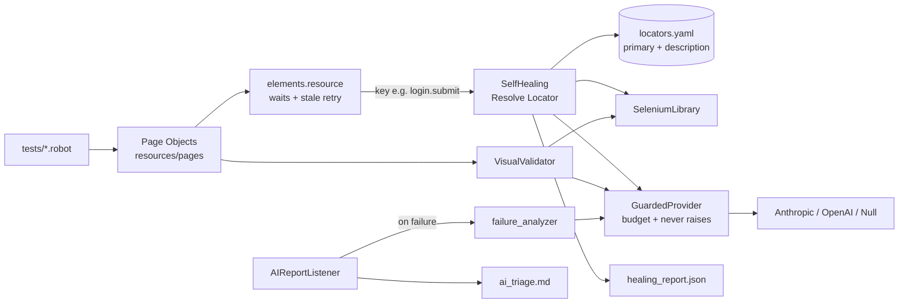

# saucedemo-robot-ai

UI test automation for [SauceDemo](https://www.saucedemo.com) built with **Robot Framework + Python + Selenium**, plus a custom **AI Test Assistant** that helps testers at runtime:

| Feature | What it does | Without AI |
|---|---|---|
| **Self-healing locators** | When a locator breaks, finds the intended element from its plain-English description and keeps the test running | Attribute/text scoring heuristic |
| **Failure triage** | Classifies every failure (`locator`, `timeout`, `assertion`, `app-defect`, `environment`), explains the likely root cause and suggests a fix | Rule-based classifier |
| **Visual checks** | Catches broken/placeholder/duplicate images and misaligned layouts; optional vision-model review | DOM geometry checks |

The AI never writes tests and never decides whether a test passes. It explains failures and repairs locators; **CI results are identical with or without an API key.**

---

## Quick start

```bash
python3 -m venv .venv && source .venv/bin/activate
pip install -r requirements.txt
cp .env.example .env            # optional: AI is off by default

robot -A robot.args tests       # all UI suites (~1 min)
pytest                          # unit tests for the Python libraries (no network)
```

Chrome must be installed; Selenium Manager downloads the matching driver. Open `results/report.html`, `results/log.html` and `results/ai_triage.md` afterwards.

### More ways to run

```bash
pabot --processes 4 -A robot.args tests && python -m libraries.ai_assist.reports results   # parallel (~30 s) + merged AI reports
robot -A robot.args --include smoke tests                   # by tag
robot -A robot.args --exclude known-bug tests               # healthy users only
robot -A robot.args --test "Checkout Requires*" tests       # by name
HEADLESS=false BROWSER=firefox robot -A robot.args tests    # headed Firefox
```

`robot.args` adds `--pythonpath .`, `--outputdir results`, `--skiponfailure known-bug`, the AI listener and `--xunit xunit.xml` (JUnit XML at `results/xunit.xml` for Jenkins, GitLab or any CI test-report widget).

### Run in Docker (no local Python or Chrome)

```bash
docker compose run --rm tests                                             # full suite, results in ./results
docker compose run --rm tests robot -A robot.args --include smoke tests   # any robot/pabot/pytest command
```

The image ships Debian Chromium + chromedriver (amd64 and arm64), always headless. `.env` is picked up if present.

### Enable AI (optional)

```ini
# .env
AI_PROVIDER=anthropic          # anthropic | openai | none
AI_MODEL=claude-opus-5-5       # any model id your provider accepts
ANTHROPIC_API_KEY=sk-ant-...
AI_MAX_CALLS=20                # per-run budget shared by all AI features
```

A missing key, unknown model, network error or exhausted budget is logged as a warning and the heuristic result is used. An AI problem can never fail a test.

---

## Configuration

| Variable | Default | Purpose |
|---|---|---|
| `BASE_URL` | `https://www.saucedemo.com` | Application under test |
| `BROWSER` | `chrome` | Any SeleniumLibrary browser (`chrome`, `firefox`, `edge`) |
| `HEADLESS` | `true` | Run without a visible window |
| `TIMEOUT` | `10` | Explicit-wait timeout in seconds (no sleeps anywhere) |
| `AI_PROVIDER` | `none` | `anthropic`, `openai` or `none` |
| `AI_MODEL` | – | Model id; never hardcoded in code |
| `ANTHROPIC_API_KEY` / `OPENAI_API_KEY` | – | Provider credentials |
| `AI_MAX_CALLS` | `20` | Cap on AI calls per run (per pabot worker) |

Real environment variables override `.env`. A typo in `AI_PROVIDER` fails fast instead of silently disabling AI.

---

## Project structure

```
tests/                      login, inventory, cart, checkout (.robot) — readable specs, no locators
resources/
  common.resource           browser open/close + per-test state reset, all from config
  elements.resource         locator-key actions: explicit waits, stale-retry, self-healing
  pages/                    Page Objects: actions + named verifications
locators/locators.yaml      every locator: {primary, description}
libraries/
  utils/                    config.py (.env → typed Config / Robot variables), data_loader.py
  ai_assist/
    providers.py            AIProvider base, Anthropic/OpenAI/Null, call budget + fail-safe guard
    self_healing.py         Resolve Locator keyword
    failure_analyzer.py     rule-based triage + optional AI root cause, markdown report
    visual_validator.py     image/alignment checks + advisory vision check
    reports.py              merges per-worker reports after pabot
listeners/AIReportListener.py   triages every failure, writes ai_triage.md
data/                       users.yaml, checkout.csv (data-driven rows)
unit_tests/                 pytest with FakeProvider and fake SDK modules, no network
.github/workflows/tests.yml CI: unit tests + libdoc, UI tests in parallel, triage as job summary
```

## Architecture



**Layers.** Tests read like specifications (`Cart Badge Should Show    2`). Page Objects own every action and verification. `elements.resource` is the single point where a locator key becomes an element, so waits, stale-element retries and self-healing are written once and every page benefits. Python libraries hold the logic; their decision functions are pure and unit-tested, with thin Robot keyword wrappers.

**One gate for AI.** Every AI feature calls `get_provider()`, a `GuardedProvider` that enforces the call budget, catches every exception and returns `None` on any problem. Each feature computes its heuristic answer first and uses AI only to improve it.

---

## The AI Test Assistant

### Self-healing locators

Each entry in `locators.yaml` has a `primary` locator and a human `description`:

```yaml
login:
  submit:
    primary: css:[data-test="login-button"]
    description: Login submit button
```

`Resolve Locator` waits for `primary`. If it never appears:

1. Every visible element is scored against the description (text, `data-test`, id, name, aria-label, placeholder, element role).
2. A clear winner (score ≥ 0.6 and ≥ 0.15 ahead of the runner-up) is used. Ambiguous cases, such as six identical "Add to cart" buttons, go to the AI with the top 15 candidates, or fail if AI is off.
3. The healed locator is cached for the run and logged as a WARN, and the test gets the `healed` tag. `results/healing_report.json` records `old → new`, source and confidence.

`locators.yaml` is never rewritten automatically; a human accepts the suggestion. The test `Self-Healing Recovers An Outdated Login Button Locator` uses a deliberately broken locator to demonstrate this.

### Failure triage

`AIReportListener` runs on every failed test, including `known-bug` failures turned into skips. It captures the URL, any visible error banner, the page HTML and a screenshot, then:

- **Heuristics** classify by message patterns. A visible app error, or a `known-bug` tag, makes it an `app-defect`. Example: *problem_user* checkout is triaged as *"App showed an unexpected error: Error: Last Name is required"*, while the test itself only knew the Finish button never appeared.
- **AI (optional)** adds a root-cause hypothesis and suggested fix from the message, HTML and screenshot.

The triage is appended to the test message in `log.html`/`report.html`, and `results/ai_triage.md` summarises the run. In CI it becomes the job summary.

### Visual checks

| Keyword | Kind | Catches |
|---|---|---|
| `Images Should Be Valid` | deterministic, fails test | images that didn't load, placeholder/404 images, duplicates, size outliers |
| `Elements Should Be Aligned` | deterministic, fails test | elements leaving the grid columns, size outliers |
| `Screen Should Match Description` | AI vision, advisory | anything else visible; logs WARN, never fails |

---

## Test coverage and known defects

37 tests across login (9), inventory (16), cart (5) and checkout (7, data-driven from `data/checkout.csv`).

Tags: `smoke`, `regression`, `negative`, `edge`, `known-bug`, `ai`, plus runtime `healed`.

Tests for SauceDemo's intentionally buggy users **assert correct behaviour** and are tagged `known-bug`. `--skiponfailure known-bug` reports them as **SKIP** with the original failure and triage, so CI stays green and the defects stay visible:

| Test | Defect found |
|---|---|
| Problem User Can Sort Products | Price sort has no effect |
| Problem User Can Add Every Product | Only 3 of 6 products can be added |
| Error User Can Add Every Product | Only 3 of 6 products can be added |
| Problem User Sees Correct Product Images | All product images are the 404 placeholder |
| Visual User Sees Correct Product Images | Backpack shows placeholder, wrong size (262×238 vs 159×238) |
| Visual User Sees Aligned Product Cards | Last "Add to cart" button is off the grid (x=1102 vs 1048) |
| Problem User Can Complete Checkout | Last Name field doesn't keep input → "Last Name is required" |
| Error User Can Complete Checkout | Finish button doesn't complete the order |

If SauceDemo fixes a defect, its test starts passing, which is the signal to drop the tag.

---

## Design decisions

- **Page Object Model with named verifications.** Page resources expose actions *and* `… Should …` keywords, so tests never touch locators or raw SeleniumLibrary calls.
- **No sleeps.** Every action waits explicitly. React re-renders are handled by a bounded `Retry On Stale Element` around each action, not by delays.
- **Healing only where absence is a bug.** Count and "is gone" checks use the plain locator, because zero elements is a valid answer there.
- **AI is advisory.** Only deterministic checks fail tests; AI output is clearly labelled (`via ai` / `via heuristic`).
- **Lazy SDK imports.** `anthropic` and `openai` are only imported when selected.
- **Chrome password manager disabled.** `secret_sauce` is a known breached password; Chrome's warning bubble steals keyboard focus after the first login.

### Known limits

- The AI call budget is per process, so each pabot worker has its own `AI_MAX_CALLS`.
- Healing starts only after the primary locator times out, so a broken locator costs one timeout. Later uses in the same run hit the cache.
- Visual heuristics assume grid-like layouts (shared columns, uniform sizes).

---

## CI

`.github/workflows/tests.yml` runs on push, pull request and manual dispatch:

- **unit**: `pytest` plus `libdoc` HTML for every keyword library (artifact `keyword-docs`).
- **ui**: Chrome headless, `pabot --processes 4`, merged AI reports, `ai_triage.md` and healed locators published as the job summary, full `results/` uploaded as artifact `robot-results`.

AI turns on in CI only when the repository has an `ANTHROPIC_API_KEY` secret. Optional repository variables `AI_MODEL` and `AI_MAX_CALLS` override the defaults.

## Extending

- **New page:** add locators with descriptions to `locators.yaml`, create `resources/pages/<Name>Page.resource` using `elements.resource` keywords, and write tests against its keywords.
- **New data-driven case:** add a row to `data/checkout.csv`.
- **New AI provider:** subclass `AIProvider` in `providers.py` and add it to `create_provider`.
- **Keyword docs:** `python -m robot.libdoc --pythonpath . libraries.ai_assist.self_healing.SelfHealing docs/self_healing.html`
